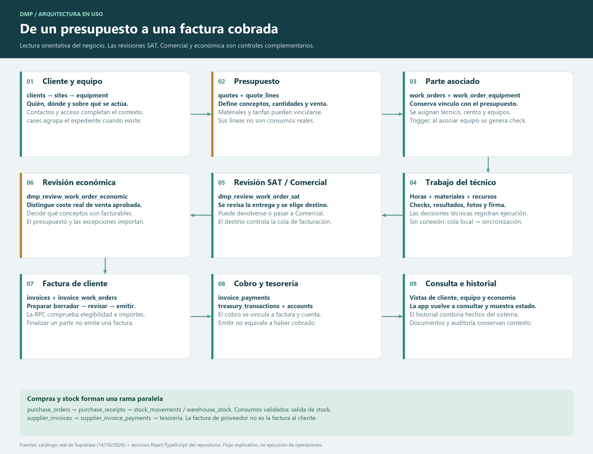

# DMP: estructura real y recorrido de los datos

Fecha de preparación: **14 de octubre de 2026**.

## Abrir los mapas

- **[Atlas interactivo](DMP-atlas.html)**: permite buscar/pulsar una tabla, ver todas sus columnas, sus FK, políticas y triggers. Las relaciones seleccionadas se resaltan en verde. Incluye el recorrido de negocio y el funcionamiento al abrir una pantalla. Funciona localmente, sin conexión ni claves. GitHub muestra el HTML como código: descarga/clona el repositorio y abre el archivo en el navegador, conservando sus archivos vecinos.
- **[Imagen completa](DMP-tablas-relaciones.png)**: todas las tablas, vistas y enlaces estructurales exportados.
- **[Mapa vectorial](DMP-tablas-relaciones.svg)**: ampliable sin pérdida de nitidez. Cada relación conserva un título con su restricción y columnas.
- **[Del presupuesto al cobro](DMP-recorrido-del-dato.png)** · [SVG](DMP-recorrido-del-dato.svg): presupuesto → parte → ejecución → revisiones → factura → cobro.
- **[Qué ocurre al abrir un parte](DMP-al-abrir-un-parte.png)** · [SVG](DMP-al-abrir-un-parte.svg): sesión, permisos, consultas, interfaz, guardado y sincronización.
- **[Relaciones completas CSV](relaciones-completas.csv)**: listado exacto de las 354 claves foráneas.
- **[Catálogo real JSON](live-catalog.json)**: exportación estructural recibida del proyecto real; no contiene registros de negocio.
- **[Catálogo con índice de servicios](catalog.json)**: estructura real junto con los servicios que la utilizan en el código.

[](DMP-recorrido-del-dato.png)

## Qué se ha verificado en Supabase

Se utilizó el resultado de `supabase/verification/export_architecture_catalog_readonly.sql`, ejecutado por el usuario en el proyecto DMP. La captura del catálogo está fechada el **14/10/2026 a las 19:25:23 UTC** (21:25 en Madrid).

| Esquema | Tablas | Vistas | Función |
| --- | ---: | ---: | --- |
| `public` | 89 | 15 | Datos y consultas de DMP. |
| `auth` | 27 | 0 | Autenticación administrada por Supabase. |
| `storage` | 8 | 0 | Metadatos internos del almacenamiento de archivos. |
| **Total** | **124** | **15** | **139 objetos representados**. |

La exportación contiene **354 FK**, **76 dependencias de vistas**, **72 triggers**, **439 firmas de funciones públicas** y **344 políticas RLS**. Las funciones incluyen sobrecargas, utilidades y extensiones, no solo funciones de negocio. Estas cifras corresponden a los esquemas exportados, no a todos los esquemas internos de PostgreSQL/Supabase.

El mapa verifica que están representadas **354 de 354 FK** y **76 de 76 dependencias de vistas**, con sus tablas de origen/destino. Una línea continua es una FK, con dirección **tabla hija → tabla referenciada**; una discontinua es una dependencia **vista → tabla/vista consultada**. Cada FK puede contener varias columnas, por ejemplo `company_id` junto con un identificador: sigue siendo una única restricción.

La numeración de migraciones no se ha utilizado como prueba de que estén todas aplicadas: el catálogo exportado es la autoridad para la estructura actual.

## Cómo está programado actualmente

La aplicación revisada usa **React + TypeScript**, se compila con **Vite** y utiliza **React Router** para las rutas. El estado de servidor se gestiona con **TanStack Query**, a través del adaptador `src/query/useLoad.ts` y consultas específicas. La conexión con Supabase está en `src/lib/supabase/client.ts`.

Los servicios de `src/services/` consultan tablas/vistas mediante el cliente Supabase, llaman a funciones PostgreSQL mediante `supabase.rpc(...)` y gestionan archivos en Storage. No hay un servidor Java/Spring intermedio en este recorrido del código revisado. `docs/04-arquitectura.md` describe una arquitectura conceptual anterior que no debe confundirse con la implementación actual.

La lógica de negocio está repartida entre:

1. **Pantallas y componentes**: qué se muestra, qué campos se piden y qué acciones se ofrecen.
2. **Servicios TypeScript**: consultas, composición de respuestas, normalización y llamadas de negocio.
3. **PostgreSQL**: tablas, claves, restricciones, funciones RPC, triggers, vistas y políticas RLS.
4. **Supabase Auth/Storage**: identidad del usuario y archivos privados.
5. **IndexedDB del dispositivo técnico**: cambios locales pendientes de sincronización.

## Los núcleos del modelo

| Núcleo | Tablas principales | Para qué se usa |
| --- | --- | --- |
| Identidad | `companies`, `profiles`, `roles`, `profile_roles`, `permissions`, `role_permissions` | Empresa, perfil y acciones autorizadas. `auth.users` aporta la identidad de acceso. |
| Visibilidad | `app_modules`, `profile_module_visibility`, `profile_permission_grants`, `platform_superadmins` | Módulos visibles, permisos adicionales y ámbito de administración. |
| Cliente y ubicación | `clients`, `client_contacts`, `sites`, `site_contacts`, `access_requirements` | Quién encarga el trabajo, dónde se realiza y cómo acceder. |
| Equipo | `equipment`, `equipment_types`, `equipment_components`, `equipment_photos`, `equipment_status_history` | Activo intervenido, características, componentes y evolución. |
| Comercial | `opportunities`, `quotes`, `quote_lines`, `quote_status_history`, `rate_catalog`, `rate_versions`, `technician_hour_rates` | Oferta, líneas previstas y referencias tarifarias. |
| Expediente | `cases`, `case_events`, `case_documents`, `case_links` | Agrupación y seguimiento de actuaciones relacionadas. |
| Parte | `work_orders`, `work_order_equipment`, `work_order_assignments` | Trabajo, equipos asociados y responsables. |
| Ejecución | `work_order_time_entries`, `work_order_materials`, `work_order_cost_entries`, `work_order_notes` | Horas, consumos, recursos y anotaciones reales. |
| Decisiones previstas | `work_order_planned_material_decisions`, `work_order_quote_line_decisions` | Lo realizado o descartado respecto a las líneas del presupuesto. |
| Evidencias | `work_order_photos`, `work_order_signatures`, `files` | Fotos, firmas y metadatos de los archivos. |
| Checks | `checks`, `check_templates`, `check_template_sections`, `check_template_items`, `check_section_results`, `check_item_results`, `check_photos` | Plantilla de revisión, ejecución y resultados por bloque/ítem. |
| Deficiencias | `deficiencies`, `corrective_actions` | Problemas detectados y actuaciones correctivas. |
| Stock | `materials`, `warehouses`, `warehouse_stock`, `stock_movements`, `warehouse_stock_reconciliations` | Catálogo, cantidades por almacén, movimientos y ajustes trazados. |
| Compras | `suppliers`, `material_suppliers`, `purchase_orders`, `purchase_order_lines`, `purchase_receipts`, `purchase_receipt_lines` | Proveedor, pedido y recepción efectiva. |
| Factura de proveedor | `supplier_invoices`, `supplier_invoice_lines`, `supplier_invoice_allocations`, `supplier_invoice_payments` | Documento recibido, líneas, vínculos a recepciones y pagos. |
| Factura de cliente | `invoices`, `invoice_work_orders`, `invoice_payments` | Factura propia, partes incluidos y cobros. |
| Tesorería | `treasury_accounts`, `treasury_transactions` | Cuentas y movimientos de dinero. |
| Documentación | `documents`, `document_links`, `files`, `storage_cleanup_queue` | Documentos, vinculación a recursos, archivos y limpieza controlada. |
| Avisos | `alerts`, `alert_recipients` | Mensaje y destinatarios. Véase la diferencia de código/base detectada más abajo. |
| Registros | `vehicles`, `personnel_certificates` | Vehículos, responsabilidades y documentación/caducidades de PRL. |
| Auditoría | `audit_log`, `activity_log` y tablas de recibos de operaciones | Trazabilidad de acciones e idempotencia de determinados flujos. |

El explorador incluye también las tablas auxiliares y las tablas internas de Auth y Storage, aunque no se repitan todas en esta explicación abreviada.

## Ejemplo: qué ocurre cuando abres un parte

1. **Ruta**: React Router identifica la ficha solicitada y el espacio de trabajo. El identificador de la URL no sustituye a la autorización.
2. **Sesión y perfil**: Supabase Auth identifica al usuario. `profilesService.getCurrentProfile()` obtiene `profiles`, sus roles y `dmp_get_current_access`. Comprueba además que el perfil esté activo y no borrado.
3. **Ámbito de acceso**: la interfaz controla rutas/acciones, y la base aplica RLS y comprobaciones dentro de RPC. El código limpia caché y URLs firmadas al cambiar la identidad/ámbito. Que una tabla tenga RLS activado no demuestra por sí solo que todas sus políticas sean correctas.
4. **Caché o consulta**: `useLoad` usa TanStack Query con una clave que incluye el ámbito. La configuración revisada permite reutilizar datos recientes durante 30 segundos; la caché puede evitar una nueva petición inmediata. El refresco explícito vuelve a consultar.
5. **Validación del técnico**: el acceso técnico al parte comprueba una asignación activa y que el estado permita trabajo operativo antes de cargar el detalle. Otros roles siguen sus rutas y permisos respectivos.
6. **Cabecera**: `getWorkOrderFullDetail()` consulta el parte junto con cliente, centro, expediente, contacto, equipo principal y perfiles relacionados.
7. **Detalle**: reúne equipos asociados, plantillas compatibles, asignaciones, historial de estados, horas, notas, materiales, recursos, checks, deficiencias, avisos, documentos, firmas y fotos. Si existe presupuesto, añade sus líneas y decisiones. No todas estas consultas son una sola petición ni son siempre paralelas.
8. **Presentación**: React combina el resultado y presenta bloques adaptados al perfil. Los archivos privados se resuelven con URLs firmadas. La pantalla de resumen tiene un cargador más ligero que el detalle completo.
9. **Guardar**: la acción correspondiente envía los datos a un servicio, que usa una modificación de tabla o una RPC. Las operaciones sensibles pueden validar perfil, empresa, estado e importes dentro de PostgreSQL, y ejecutar triggers asociados.
10. **Respuesta**: la interfaz muestra éxito/error y refresca los datos necesarios. Un cambio guardado localmente por el técnico sigue pendiente hasta que se sincroniza correctamente.

Fuentes de este ejemplo: `src/App.tsx`, `src/services/profilesService.ts`, `src/services/workOrdersService.ts`, `src/query/useLoad.ts`, `src/query/queryDefaults.ts`, `src/query/accessScope.ts`, `src/services/technicianOfflineService.ts` y el catálogo real exportado.

## Cómo recorre el sistema un dato de trabajo

Un equipo pertenece a un cliente y puede estar en un centro. Un presupuesto define líneas previstas y puede vincularse a un expediente, equipo y parte. El parte conserva el vínculo de origen y puede tener **varios equipos** mediante `work_order_equipment`; `main_equipment_id` identifica el principal.

En la base real existe `trg_auto_check_work_order_equipment`, un trigger **AFTER INSERT** sobre `work_order_equipment`. Llama a `dmp_auto_check_for_work_order_equipment`. El código SQL versionado de esa función solicita el check del equipo mediante una función de creación/reutilización. Se ha verificado la existencia del trigger y sus funciones, sin insertar equipos para probarlo.

El técnico registra trabajo, horas, consumos, recursos, checks y evidencias. Las tablas de ejecución no son las mismas que las líneas del presupuesto. Para el trabajo sin conexión, `technicianOfflineService` utiliza IndexedDB (`doormanager-pro-tecnico`, almacén `offline_changes`), distingue perfil/empresa y conserva estados de sincronización y claves de cambio para controlar reintentos.

SAT revisa la entrega y decide el destino; Comercial interviene cuando corresponde. La revisión económica determina facturabilidad y venta aprobada. **Coste real, venta propuesta, venta aprobada y total de factura son magnitudes diferentes.** Validar horas/materiales no equivale por sí solo a emitir la factura ni significa que el cliente pague automáticamente la suma de consumos reales. El precio presupuestado, las decisiones económicas y las excepciones influyen en la venta y preparación del borrador.

En el código actual, preparar una factura requiere revisar la elegibilidad del parte. Entre los controles figuran facturabilidad, venta positiva, revisión económica/validación histórica, destino SAT/Comercial y ausencia de un borrador/factura activa incompatible. `dmp_prepare_invoice_from_work_order` prepara el borrador y `dmp_issue_invoice` intenta emitirlo con sus validaciones. El cobro se registra después y se vincula a tesorería.

Las compras siguen otra rama: proveedor → pedido → recepción confirmada → entrada de stock. Los consumos del parte se registran y validan por su propio recorrido; la existencia de un consumo no demuestra que ya haya descontado stock. La factura del proveedor y su pago pertenecen al circuito de compras, no al de facturación al cliente.

## Relaciones físicas y relaciones lógicas

No todos los vínculos de la aplicación se expresan como FK. Por ejemplo:

- `alerts.related_entity` + `related_id` apuntan de forma lógica al recurso mencionado.
- `document_links.related_type` + `related_id` vinculan un documento con distintos tipos de recurso.
- `files` guarda metadatos; el binario se almacena en Storage. La ruta/bucket del objeto y la URL firmada no son una relación SQL convencional entre todas esas entidades.
- La cola local de IndexedDB está en el dispositivo, no es otra tabla PostgreSQL.

Por eso el mapa de FK y el recorrido funcional se entregan por separado: mostrar una flecha de proceso como si fuera una clave foránea daría una idea incorrecta del modelo.

## Diferencias reales detectadas entre el código y la base

Se compararon las llamadas RPC con nombre literal detectadas en los servicios contra las funciones del esquema público exportado. Se encontraron estas ausencias:

| Función llamada por el código | Dónde se usa | Qué implica |
| --- | --- | --- |
| `dmp_list_personal_alerts` | `src/services/alertsService.ts`, `listPersonal()` | La bandeja individual depende de una RPC que no aparece en el catálogo exportado. Explica una posible causa del fallo de carga, sin haber ejecutado esa operación en esta revisión. |
| `dmp_set_work_order_billing_decision` | `src/services/workOrdersService.ts`, decisión de facturación de garantía | La acción correspondiente puede fallar por ausencia de esa función. No demuestra que toda la facturación esté rota. |

Tampoco aparece `public.alert_personal_states`, que sí está definido en una migración del repositorio. No se ha deducido de esto que haya que ejecutar automáticamente ninguna migración: antes de reparar hay que revisar la compatibilidad de funciones, permisos y datos existentes. **No se han modificado datos ni funciones de producción para elaborar el atlas.**

El cotejo es estructural. No se han exportado los cuerpos actuales de las funciones ni probado la corrección de cada política, trigger o regla con datos de negocio. Los diagramas de proceso explican el código revisado y la existencia de sus objetos de base, sin certificar todas las ramas de ejecución en producción.

## Reproducir o actualizar

```powershell
node scripts/build-architecture-catalog.mjs --live docs/architecture-map/live-catalog.json
node scripts/render-architecture-map.mjs
node scripts/render-architecture-flows.mjs
```

Las imágenes PNG se renderizan con `scripts/render-architecture-png.py` y Pillow. El script usa fuentes locales Segoe UI. El archivo `render-check.json` permite comprobar cobertura de objetos y relaciones. Para actualizar producción se necesita una **nueva exportación** del catálogo; regenerar a partir de migraciones locales no acredita cambios en la base real.
